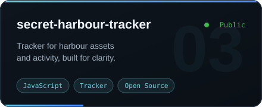
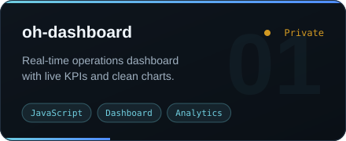
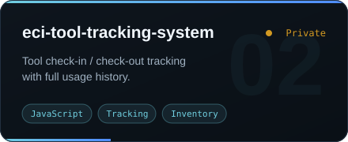
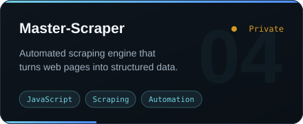

 

## `> about --me`

## `> ls ./projects`

🔒 Private projects: architecture walkthroughs and demos available on request.

## `> git log --graph`

<picture>
  <source media="(prefers-color-scheme: dark)" srcset="https://raw.githubusercontent.com/diyaguglanikantar01/diyaguglanikantar01/output/github-contribution-grid-snake-dark.svg">
  <source media="(prefers-color-scheme: light)" srcset="https://raw.githubusercontent.com/diyaguglanikantar01/diyaguglanikantar01/output/github-contribution-grid-snake.svg">
  
</picture>

  

## `> contact --open`

Built with hand-made SVG + GitHub Actions. Updates itself daily.

