 

## `> whoami`

## `> ls ./projects`

<!--PROJECTS:START-->

<!--PROJECTS:END-->

🟢 active (pushed &lt; 30 days) &nbsp; 🟡 idle (&lt; 120 days) &nbsp; ⚪ dormant &nbsp;·&nbsp; 🔒 private projects: walkthroughs on request

## `> uptime --rhythm`

## `> git log --graph`

  

<picture>
  <source media="(prefers-color-scheme: dark)" srcset="assets/snake-dark.svg">
  <source media="(prefers-color-scheme: light)" srcset="assets/snake-light.svg">
  
</picture>

  

 
Generated from <code>profile.config.json</code> · refreshes every 6 hours

